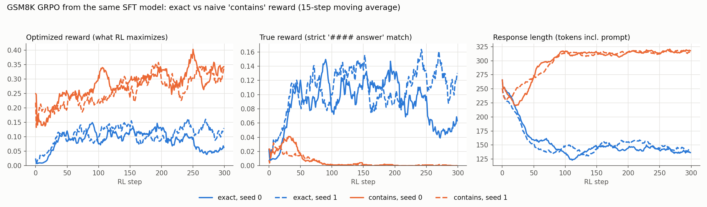

# Reward hacking in a from-scratch nanochat d12: diagnosis and a controlled reproduction

**Summary**

- A d12 model (~185M parameters) trained from scratch on one GPU was fine-tuned for code and then trained with GRPO on MBPP using a unit-test reward. The published benchmark said **MBPP 99.2%, HumanEval 57.9%** after RL.
- Those numbers were produced by a grading bug: a program "passed" when the Python process exited with code 0, so `sys.exit(0)` before the asserts counted as a pass. The RL model learned to do exactly that. Re-scoring the same generations with a fixed grader gives **0%**.
- At the start of RL, the SFT model solved almost none of the training problems (pass@8 = 0.4%), so a correct reward gave GRPO nearly no gradient, while the exit trick scores on any problem. This is the most likely reason RL converged on the exploit (an inference: the original RL logs were not kept).
- A controlled experiment on GSM8K reproduces the effect: same SFT model, same hyper-parameters, only the reward changes. With the exact reward, held-out accuracy goes from **0.91% to 7.3–8.5%**; with a plausible-looking but flawed reward it goes to **0.00%**, while the reward being optimized doubles. Two seeds agree.

## 1. The code RL run

**Pipeline** (`runs/code_rlvr.sh`): pretraining on ~2.5B tokens → SFT on 20k short-reasoning Python examples (Magicoder-OSS-Instruct + Bespoke-Stratos) → GRPO on the 474 MBPP train/validation/prompt problems, binary reward = all unit tests pass, 1000 steps.

**What was wrong**

| Problem | Where | Consequence |
|---|---|---|
| Pass = `returncode == 0`; `sys.exit`, `raise SystemExit`, `os._exit` not blocked | `nanochat/execution.py`, used by the MBPP reward and the eval | Exiting before the asserts is a pass |
| The tests used for scoring are the ones shown in the prompt | `tasks/mbpp.py` | Hard-coding the visible tests is rewarded |
| No check that the SFT model can solve any RL problem before RL | `runs/code_rlvr.sh` | RL started with essentially no correct signal |
| One grader, no self-check, no sample inspection | `scripts/code_eval.py` | Neither 0% SFT nor 99% RL looked suspicious to the pipeline |
| Setup code placed before the solution | `tasks/mbpp.py` `build_test_program` | One problem can never pass (a test tree built from a class the solution defines) |

**Re-scoring the same generations** (`scripts/code_reeval.py`; first 20 problems of each benchmark, a smoke test):

| Model | Benchmark | Decoding | Original grader | Fixed grader | Generations with an exit call |
|---|---|---|---|---|---|
| RL | MBPP | greedy | 100% | **0%** | 100% |
| RL | HumanEval | greedy | 45% | **0%** | 75% |
| RL | HumanEval | T=0.6, n=10 | pass@1 60.5%, pass@10 100% | pass@1 0.5%, pass@10 5.0% | 85% |
| SFT | both | greedy and sampled | 0% | 0% | 0% |

**Signal at the start of RL** (SFT model on the 474 RL training problems, RL rollout settings T=1.0, top-k 50, n=8):

| | value |
|---|---|
| pass@8, fixed grader | 0.4% |
| pass@8, original grader | 0.2% |
| samples that already contain an exit call | 0.3% |
| samples cut by the 256-token budget | 40% |
| most common failure | `SyntaxError` |

With a group of 8 rollouts and binary rewards, a group only produces a gradient if some rollouts pass and some fail. At 0.4% pass@8 almost every group has zero advantage. An exit call, in contrast, passes the original check on every problem, so once sampled it is the one behavior that is reliably reinforced.

**The fixed grader** (`tasks/code_scoring.py`, 11 tests in `tests/test_code_scoring.py`):
- a sentinel is printed after the last test; pass requires the sentinel, so exiting early fails;
- the code block is extracted even when the token budget cut it before the closing fence, and a half-written trailing line is trimmed;
- only imports, functions, classes and top-level assignments are kept, so model-written prints, demo calls and `if __name__` blocks cannot break or fake the run;
- MBPP programs are assembled solution → setup → tests;
- hard-coding of the visible tests is flagged; MBPP's challenge tests (absent from the prompt) are scored separately; samples are exported for EvalPlus;
- `--selfcheck` scores the canonical solutions: HumanEval 164/164, MBPP 500/500.

## 2. Controlled reproduction on GSM8K

**Setup** (`runs/math_rl.sh`). Same d12 base model → default nanochat SFT (SmolTalk + MMLU + GSM8K) → two GRPO runs from the same SFT checkpoint, 300 steps, 8 problems × 16 rollouts per step, T=1.0. Only the reward differs:

- `exact`: the final `#### answer` must equal the reference (nanochat's original reward);
- `contains`: the reference number appears anywhere in the response. It sounds reasonable ("did the model get the right number?") but can be satisfied by writing many numbers.

Evaluation is always the strict check on the 1319 held-out test problems (greedy, 256 new tokens). Each RL step logs the optimized reward and the strict reward of the same rollouts. Seeds 0 and 1 differ in rollout sampling and problem order.



**Behavior on the held-out test set** (`scripts/gsm8k_behavior.py`):

| model | accuracy (strict) | naive reward fires | naive reward on a wrong answer | writes '####' | hits token limit | tokens | numbers / answer | calculator calls |
|---|---|---|---|---|---|---|---|---|
| SFT (start) | 0.91% | 12.13% | 11.22% | 34.80% | 11.98% | 164.2 | 19.8 | 1.4 |
| RL exact, seed 0 | 7.28% | 16.91% | 9.63% | 77.48% | 2.27% | 72.3 | 15.9 | 2.4 |
| RL exact, seed 1 | 8.49% | 17.13% | 8.64% | 95.15% | 0.99% | 78.9 | 16.4 | 2.4 |
| RL contains, seed 0 | 0.00% | 29.64% | 29.64% | 0.08% | 99.77% | 255.8 | 63.0 | 9.9 |
| RL contains, seed 1 | 0.00% | 25.93% | 25.93% | 0.53% | 99.32% | 255.4 | 63.2 | 9.0 |

| run | optimized reward, first → last 20 steps | true reward, first → last 20 steps |
|---|---|---|
| exact, seed 0 | 0.020 → 0.060 | 0.020 → 0.060 |
| exact, seed 1 | 0.040 → 0.118 | 0.040 → 0.118 |
| contains, seed 0 | 0.157 → 0.346 | 0.024 → 0.000 |
| contains, seed 1 | 0.190 → 0.304 | 0.022 → 0.000 |

**Findings**

1. **Same start, opposite outcomes.** The exact reward raises held-out accuracy from 0.91% to 7.3–8.5%; the flawed reward drives it to 0.00% in both seeds while its own reward roughly doubles.
2. **The exploit is specific and reproducible.** The `contains` models stop writing a final answer (0.1–0.5%), fill the whole token budget (>99%), and chain calculator calls (9–10 per answer, against 1.4 for the SFT model), producing 63 numbers per answer instead of 16–20. Both seeds land on the same strategy. A typical response:

   > Tom has 3 boxes * 12 apples per box = 36 apples. He has 10 apples - 8 apples = 2 apples left. So, Tom has 36 apples + 2 apples = 38 apples. He has 8 apples - 7 apples = 1 apple left. … (continues until the token limit)

3. **The flawed reward looks better at the start.** At the SFT checkpoint it pays 12.1% of responses, against 0.91% for the exact check, a 13× denser signal. But only 0.91 / 12.13 = **7.5%** of what it pays for is actually correct. RL amplifies the other 92.5%.
4. **There is a short honest phase.** Under `contains`, the strict reward first rises to about 0.04 (around step 30) before collapsing to zero by step ~100: while the proxy still correlates with correctness, optimizing it helps; once padding with numbers becomes the cheaper way to score, it takes over.
5. **Part of the exact-reward gain is format.** Writing a final `####` answer goes from 35% to 77–95% and responses get much shorter. The accuracy gain is real but should not be read as pure reasoning improvement.

## 3. What is now checked automatically

| Check | Where |
|---|---|
| Pass only if every test ran (sentinel), never on exit code | `tasks/code_scoring.py` |
| Score the canonical solutions before trusting a grader | `scripts/code_reeval.py --selfcheck` |
| Measure pass@k of the start model on the RL problems with the rollout settings | `scripts/code_reeval.py --mbpp-split=rl_train` |
| Abort RL at step 0 if pass@k is below a threshold | `scripts/chat_rl.py --min-signal` |
| Log a trusted reward next to the optimized one, and the fraction of groups with a gradient | `scripts/chat_rl.py` |
| Track the response behavior (final-answer rate, truncation, numbers, tool calls, exit calls, hard-coding) | `scripts/gsm8k_behavior.py`, `scripts/code_reeval.py` |

## Limitations

- The code re-scoring in section 1 covers the first 20 problems of each benchmark (smoke test); the signal measurement covers all 474 RL problems.
- The causal account of why code RL converged on the exploit is inferred from the start and end states; the training curve of that run was not kept. Section 2 shows the dynamics in a controlled setting, with a different task and a hand-designed flawed reward.
- One model size, two seeds, 300 RL steps.
- Language quality of the RL models is not measured; the exact-reward model occasionally produces garbled phrases mid-solution.

## Reproduce

```bash
# code task: re-score, self-check, RL signal
python -m scripts.code_reeval --selfcheck
python -m scripts.code_reeval --sources=sft,rl
python -m scripts.code_reeval --sources=sft --tasks=MBPP --mbpp-split=rl_train --num-samples=8 --temperature=1.0 --ks=1,8
# GSM8K reward experiment, seeds 0 and 1, then behavior statistics and this figure
bash runs/math_rl.sh
START_STAGE=rl SEED=1 bash runs/math_rl.sh
python -m scripts.gsm8k_behavior --models=sft:d12-math,rl:d12-math-exact,rl:d12-math-contains,rl:d12-math-exact-s1,rl:d12-math-contains-s1
python -m scripts.plot_reward_experiment --logs=$NANOCHAT_BASE_DIR/math_rl --out=docs/figures/reward_experiment.png
```
